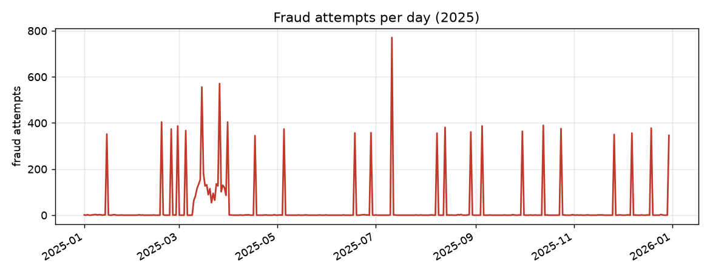
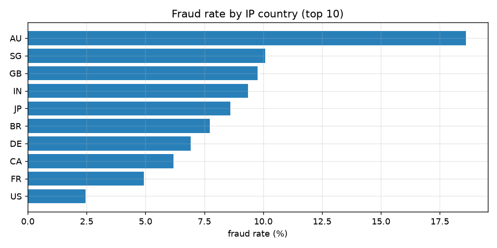
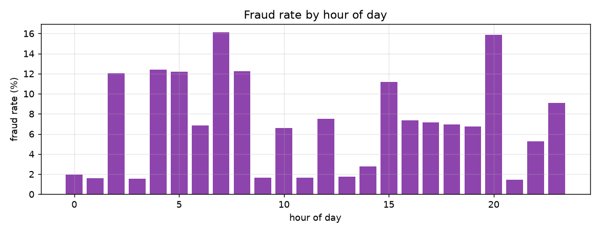
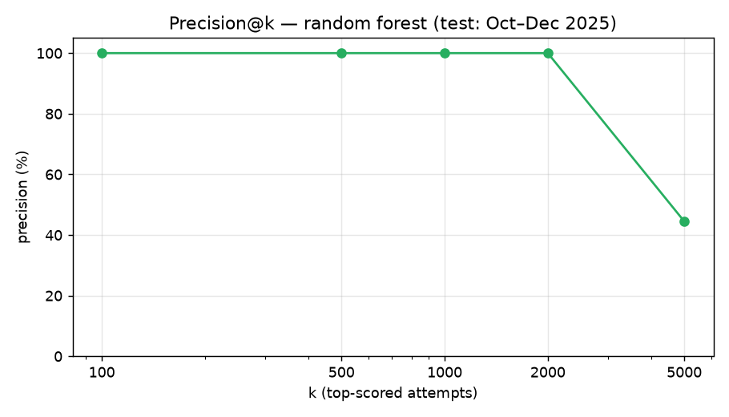
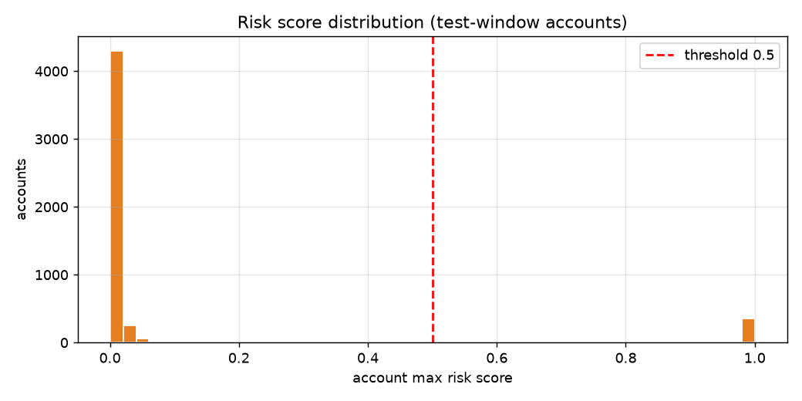
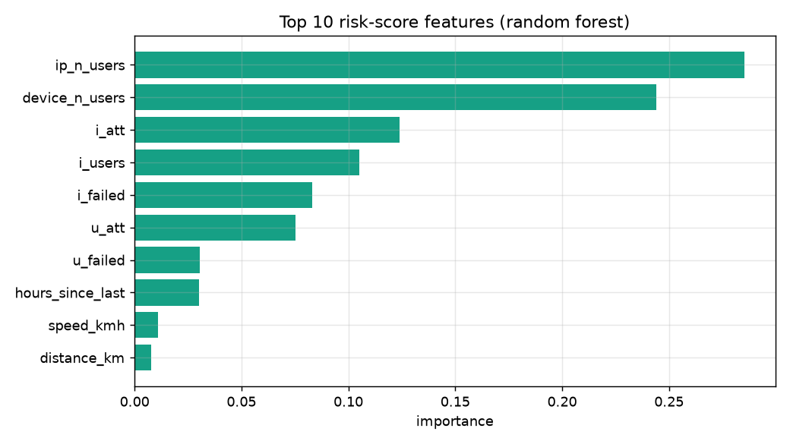
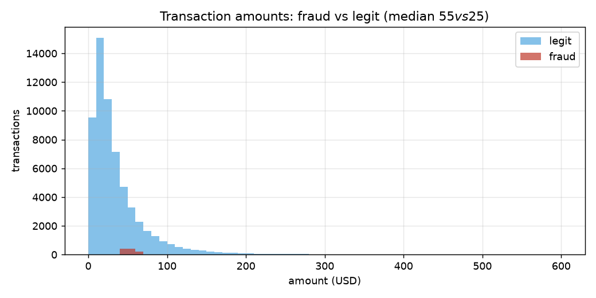

# Account Takeover & Fraud-Ring Detection

**Trust & Safety analytics — from login telemetry to risk scoring.**

Detect credential stuffing, account takeover, and coordinated fraud rings from login,
password-reset, and transaction telemetry. Score risky accounts, size the review workload,
and recommend enforcement thresholds.

## TL;DR

- **162,778 login attempts** from 5,100 users (2025-01-01 → 2025-12-31); **7.30%** are fraud.
- Fraud is **bursty, not uniform**: 48 IP–10-minute windows show 20+ attempts across 5+ users
  each (credential-stuffing shape); 35 devices are shared by 5+ users (ring shape).
- **New-device logins are 2.3× riskier** (14.44% fraud vs 6.34% on known devices, z = 31.0).
  Impossible-travel logins are *not* significantly riskier here (χ² = 0.1, p = 0.78) —
  attackers usually strike after long gaps, so speed checks rarely fire.
- A leakage-safe random forest (train Jan–Sep, test Oct–Dec) reaches **AUC 1.000**,
  **precision@2000 = 100%**, and at threshold 0.5 produces **2,195 alerts at 100% precision
  and 98.7% recall — ~24 reviews/day**.
- **Caveat:** the synthetic fraud is deliberately clean-cut, so absolute scores are
  illustrative. The methodology — past-only features, time-split evaluation, precision@k,
  threshold trade-offs — is what transfers to production.

## Data

All synthetic, generated with seed `42` (`data/generate` was run once; files are committed).
No real users. Ground-truth label columns (`is_fraud_*`) exist **for evaluation only** and
are never used as features.

| File | Rows | Fraud | Rate |
|---|---|---|---|
| `data/users.csv` | 5,100 | — | — |
| `data/devices.csv` | 7,150 | — | — |
| `data/login_attempts.csv` | 162,778 | 11,885 attempts | 7.30% |
| `data/password_resets.csv` | 483 | 120 resets | 24.85% |
| `data/transactions.csv` | 61,560 | 1,238 txns | 2.01% |

Three fraud scenarios are injected: **credential stuffing** (25 campaigns — bursts of failed
logins from one IP/device across ~60 users), **account takeover** (120 users — distant-country
login on a new device → password reset → high-value transactions), and **fraud rings**
(5 rings × 20 users sharing devices/IPs with clustered signups).

Schema details: [`data/data_dictionary.md`](data/data_dictionary.md).

## Method

1. **Data-quality audit** — missing values, duplicate keys, invalid coordinates/amounts,
   future timestamps, orphan foreign keys. Nothing failed hard rules, so
   `outputs/quarantine_log.csv` is header-only (the audit trail is kept anyway).
2. **Feature engineering (15 past-only features)** — previous login per user (LAG),
   haversine distance, hours since last login, speed, impossible-travel flag
   (>500 km at >800 km/h), new-device / new-country flags, 10-minute velocity
   (per-user and per-IP attempts/failures/distinct users), device/IP user-sharing counts,
   hour and day-of-week. Same logic in pandas and in [`sql/fraud_features.sql`](sql/fraud_features.sql)
   (BigQuery; parsed + logic-checked, not run live).
3. **Leakage-safe evaluation** — split by time *first* (train 2025-01-01→2025-09-30,
   n=122,788; test 2025-10-01→2025-12-31, n=39,990), then compute features inside each
   split. Logistic regression vs random forest; reported: ROC-AUC, average precision,
   precision@k, and threshold trade-offs.
4. **Deliverables** — executed notebook (66 cells, 0 errors), `outputs/risk_scored_accounts.csv`,
   and `dashboard/app.py` (generated by the notebook's final cell via `%%writefile`).
5. **R validation** — the three statistical checks (χ², z-test, Mann-Whitney) are replicated
   in R at `r/stats_validation.R`, run in RStudio via the bundled `.Rproj`. All numbers match
   the notebook exactly.

## Findings

### Fraud is bursty — a few windows carry most of it



Daily fraud volume is spiky: quiet days alternate with sharp bursts of 300–800 attempts.
That burstiness is the first operational signal — it is what IP-velocity rules catch.

### Where the risk concentrates



Fraud rate varies strongly by IP country — distant-country logins deserve a closer look,
but country alone is too coarse to act on (most logins from any country are legit).



### Statistical validation

| Signal | Finding |
|---|---|
| New device | 14.44% fraud (n=19,309) vs 6.34% on known devices (n=143,469), z = 31.0 — strongly significant |
| Impossible travel | 927 logins, 7.0% fraud — χ² = 0.1, p = 0.78, **no significant association** |
| Transaction amount | median fraud **$55** vs legit **$25** (Mann-Whitney p ≈ 0) |

The impossible-travel result is the interesting one: it catches only **0.5%** of fraud
attempts, because account takeovers in this data follow long idle gaps, so speed-based
checks rarely fire. Simple rules catch the rest far better:

| Rule | Share of fraud attempts caught |
|---|---|
| IP velocity (≥5 users / 10 min) | **77.8%** |
| Shared device (≥5 users) | **99.0%** |
| Impossible travel | 0.5% |

### Model results (test: Oct–Dec 2025)

| Model | ROC-AUC | Avg precision |
|---|---|---|
| Logistic regression | 1.000 | 0.998 |
| Random forest | 1.000 | 0.998 |



Precision@k stays at **100% through k = 2,000** and drops to 44.5% at k = 5,000 —
the top of the queue is pure signal, which is exactly what a human review queue needs.

| Threshold | Alerts | Precision | Recall | ≈ alerts/day |
|---|---|---|---|---|
| 0.3 | 2,195 | 100% | 98.7% | 24 |
| 0.5 | 2,195 | 100% | 98.7% | 24 |
| 0.7 | 2,195 | 100% | 98.7% | 24 |
| 0.9 | 2,195 | 100% | 98.7% | 24 |

Scores are sharply separated (everything the model flags scores ≥ 0.9), so the threshold
choice barely matters here — in production, re-tune it monthly as attackers adapt.





Sharing and velocity features dominate: distinct users per IP (0.285), distinct users per
device (0.244), and IP 10-minute attempt/user/failure counts. Movement features
(distance, speed) contribute almost nothing — consistent with the χ² result above.



## Recommendations

1. **Auto-block the obvious stuff.** IP windows with 5+ users per 10 minutes catch ~78%
   of fraud attempts at tiny volume — block or step-up-authenticate with no human review.
2. **Queue the rest by risk score.** Review top-scored accounts first; precision@k tells us
   the queue stays worthwhile down to ~k = 2,000. Budget **~24 reviews/day** at threshold 0.5.
3. **Watch device neighborhoods.** When one account on a shared device pops, re-score every
   account on that device — rings share infrastructure.
4. **Don't over-invest in impossible-travel rules.** They catch 0.5% here; keep them as a
   weak signal, not a gate.
5. **Re-tune monthly.** Attackers adapt; thresholds and feature weights decay.

One-page version for stakeholders: [`reports/stakeholder_summary.md`](reports/stakeholder_summary.md).

## How to run

```bash
pip install -r requirements.txt
# open notebooks/account_takeover_fraud_detection.ipynb and run all cells,
# then:
streamlit run dashboard/app.py
# R statistical validation (RStudio: open the .Rproj, then run):
Rscript r/stats_validation.R
```

The notebook is the source of truth: it regenerates `outputs/` and `dashboard/app.py`.
`sql/fraud_features.sql` is the BigQuery version of the feature logic.

## Project structure

```
account-takeover-fraud-detection/
├── README.md
├── requirements.txt
├── data/
│   ├── users.csv / devices.csv / login_attempts.csv / password_resets.csv / transactions.csv
│   └── data_dictionary.md
├── notebooks/
│   └── account_takeover_fraud_detection.ipynb   # 66 cells, executed, 0 errors
├── r/
│   └── stats_validation.R                      # RStudio-style R replication of the stats checks
├── account-takeover-fraud-detection.Rproj       # RStudio project file
├── sql/
│   └── fraud_features.sql                      # BigQuery feature queries
├── dashboard/
│   └── app.py                                  # generated by the notebook
├── outputs/
│   ├── risk_scored_accounts.csv
│   └── quarantine_log.csv
└── reports/
    ├── stakeholder_summary.md
    └── figures/                                # charts used in this README
```

## Caveats

- All data is synthetic with deliberately clean-cut fraud patterns — AUC ≈ 1.0 and 100%
  precision are illustrative, not production expectations.
- The SQL was parsed as BigQuery and logic-checked against the CSVs, but not run on a
  live warehouse.
- Ground-truth labels are synthetic and complete; production labels are partial
  (confirmed cases + human review), which changes calibration.
